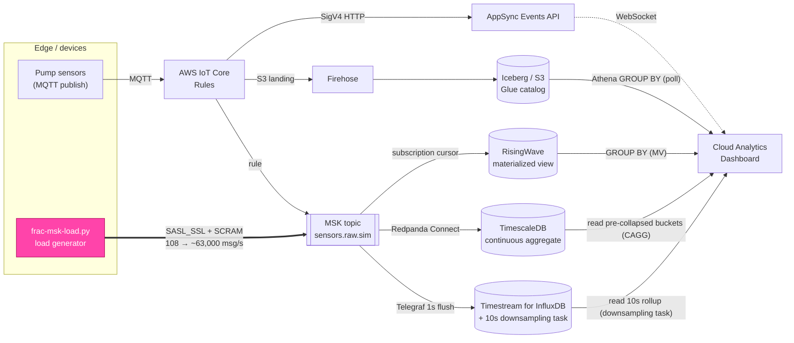

# Where do you pay for the aggregate? Four data stores serving a live freshness panel from 100 to 63,000 msg/s

*How we drove a realistic well-fracturing telemetry load into a live cloud pipeline —
on equal, realistically-sized hardware — and ramped it from 100 to ~63,000 msg/s,
watching how RisingWave, TimescaleDB, InfluxDB, and Athena/Iceberg each hold up when
you read them **the idiomatic way**: with the aggregate pre-paid on write.*

---

## The question

Our edge-to-cloud IoT workshop ends on a deliberately provocative panel: the same
pump-rate metric, shown side by side from four different data stores, each with a
live **freshness** number — how stale is the newest reading in this store, right now?

At workshop-scale traffic the panel is almost boring: every store reads sub-second
and they all look interchangeable. That is exactly the wrong lesson. The whole point
of putting four stores next to each other is that they make *different* trade-offs,
and those trade-offs only become visible under load.

So we asked a concrete question:

> If we push a realistic well-fracturing data volume — hundreds of sensors sampling
> many times a second — into the pipeline, on **equal, realistically-sized** boxes,
> and keep turning it up, **can each store keep a live freshness panel flat — and where
> does each one pay for the aggregate to do it?**

The short answer is that every store on the ingest path can keep its *read* flat all the
way to ~63,000 msg/s — **if** you read it the way it's meant to be read: with the fleet
aggregate **pre-computed on write**, not recomputed on every poll. RisingWave, TimescaleDB,
and InfluxDB each offer a native mechanism for exactly that — a streaming materialized
view, a continuous aggregate, and a downsampling task — and the interesting story is
*where* and *how* each one pre-pays. The twist is on the *other* axis — **freshness** —
which turns out to depend far less on the store than on the **write path** feeding it. Both
freshness "cracks" we hit were writer misconfigurations, not store ceilings: InfluxDB's was
a throttled Telegraf default, and TimescaleDB's — the one that took the most digging — was
two config/implementation bugs in the Redpanda Connect committer that, *together*, faked a
~30,000-msg/s ingest "ceiling" while the database itself sat near-idle. Remove them and the
idiomatic bulk-insert path sustains **~60,000 rows/s on a single 4-vCPU box with the DB
idle** — comfortably above the naïve single-row path (~30k) and above anything our generator
could actually offer — so TimescaleDB's freshness stops running away and stays **flat, ~0.1 s
from ~9k to ~63k**, the same well-behaved floor RisingWave holds, rather than the minute-plus
runaway we first saw. (An earlier draft reported this column *rising* to ~2.7 s at the top of the
ramp; that curve turned out to be a near-full data volume during a disk incident, not the offered
rate — re-run with disk headroom, it flattens. More on that below.) Read-flatness is a *query-shape*
result; freshness *behaviour* is a *write-path-configuration* result — and in this experiment
neither crack was ever the store.

This post is the write-up of that experiment: what we built to generate the load, how
the data flows, and what actually happened when we sized all three self-hosted stores
to match the managed one (**4 vCPU / 32 GiB** each) and then ramped a live slot from a
gentle **108 msg/s** up a five-step ladder to **~63,000 msg/s**.

---

## The pipeline under test

Every reading a device publishes fans out along two independent paths from a single
MQTT publish:

1. **Live push (no database):** MQTT → IoT Rules → AppSync Events API → browser
   WebSocket. Tens of milliseconds, but nothing is stored.
2. **Store-and-query:** MQTT → IoT Rules → S3 landing / MSK → the data stores.

The four stores on the freshness panel sit at different points on the
latency-vs-durability spectrum:

| Store | Role | Update mechanism | On the MSK ingest path? |
|---|---|---|---|
| **RisingWave** | Streaming materialized view | **push** (subscription cursor) | ✅ yes |
| **TimescaleDB** | Continuous aggregate (pre-collapsed 10 s buckets) | **push** (Redpanda Connect sink + CAGG refresh) | ✅ yes |
| **InfluxDB** (Timestream) | Time-series DB, read over a downsampling-task rollup | **poll** | ✅ yes |
| **Athena / Iceberg** | Warehouse / static reference | **poll** (on-demand query) | ❌ no (Firehose-fed) |

The critical detail for this experiment: **only RisingWave, TimescaleDB, and
InfluxDB consume the MSK topic directly.** Athena's Iceberg table is fed by Amazon
Data Firehose on its own cadence and is queried on demand, so it is *expected* to
stay flat regardless of ingest rate. That makes it a useful control: if Athena's
number moves, something unrelated to our load changed.

Freshness itself is computed the obvious way: `Date.now() − MAX(latest_ts)` for each
store, rendered on a log scale so a sub-second store and a 30-second store fit on the
same axis.

Here is the whole pipeline in one picture — the single MQTT publish fanning out, the
load generator we bolted onto the MSK ingest path, and the four read queries the
dashboard runs:



The thick pink edge is the only thing we added for this experiment: the load
generator producing straight into `sensors.raw.sim`, which is the one topic all three
MSK-consuming stores read.

---

## Generating a realistic frac load

A fracturing operation is not a trickle of tidy readings. A single site runs a fleet
of pump units, each carrying a bundle of sensors — pressure, rate, proppant
concentration, and so on — all sampling continuously. To be representative, the
generator had to (a) emit the *real* sensor schema the pipeline already understands,
and (b) scale smoothly from a gentle background rate up into genuine stress territory.

We built `simulator/frac-msk-load.py` for exactly this. Rather than re-implement the
sensor model, it imports the existing `build_payload` from the workshop's
`sensor-sim.py`, so the payload it produces (`{sensor, value, unit, ts_ms, site_id}`)
**cannot drift** from what the rest of the pipeline expects — it is the same code.

It produces straight to the cloud MSK cluster over `SASL_SSL` +
`SCRAM-SHA-512`, targeting the `sensors.raw.sim` topic — the one topic that reaches all
three MSK-consuming stores with **zero pipeline changes**. Throughput is a simple
product the operator dials in:

```
rate = sites × units-per-site × sensors-per-unit × hz
```

So `--sites 5 --units-per-site 10 --hz 20` with 9 sensors per unit is
`5 × 10 × 9 × 20 = 9,000 msg/s`. Each message carries a `site_id` of the form
`ws-slot42-frac-siteNN-pumpMM`, so the load shows up as a believable fleet of pumps
across sites — and, satisfyingly, those exact node names appear in the dashboard's
per-node panels once the data lands.

A single Python producer tops out near **9,000 msg/s** — past that the GIL and
serialization dominate and the producer's send buffer starts timing out. To climb the
ramp we ran the generator **horizontally**: multiple producer processes per pod, and
several pods across otherwise-idle nodes, each an independent SCRAM producer into the
same topic. Stacking them got us to a sustained **~63,000 msg/s** aggregate — the
ceiling of our generator fleet, not of any store.

A note on getting to MSK: the cluster lives in a private VPC with no public endpoint.
The intended local path is an SSH-over-SSM tunnel (`scripts/msk-tunnel.sh`) using
`sshuttle` to route the VPC CIDR. On a laptop without passwordless `sudo` (sshuttle
needs it for macOS `pfctl`), the fallback is to run the same generator from a small
pod *inside* the cloud VPC, which has native MSK reachability. That is how this run
was done — and it is also what let us scale the load out across several pods.

---

## What query each store runs — and making it fair

A freshness/latency comparison is only honest if every store answers the *same
question*. The dashboard's read is a fleet aggregate: **per site, the average free
CPU/memory and the newest timestamp** — `AVG(...) ... MAX(ts) ... GROUP BY site`.
Three of the four stores run exactly that shape server-side:

**RisingWave** — aggregates over a pre-collapsed streaming materialized view:

```sql
SELECT site_id,
       AVG(CASE WHEN sensor = 'cpu_pct'      THEN 100.0 - value END) AS avg_free_cpu_pct,
       AVG(CASE WHEN sensor = 'mem_used_pct' THEN 100.0 - value END) AS avg_free_mem_pct,
       MAX(ts_ms) AS latest_ts_ms
FROM mv_sensor_fleet_latest
WHERE deployment_id = $1
GROUP BY site_id;
```

**TimescaleDB** — the *same* aggregate, but served from a **continuous aggregate**
(`sensor_readings_cagg`) rather than the raw hypertable. TimescaleDB keeps a set of
pre-collapsed 10-second buckets (`avg(value)`, `max(ts_ms)` per `site_id`/`sensor`)
maintained incrementally on write, so the dashboard's read touches a handful of
bucket rows per series instead of every raw point in the window — the idiomatic way
to serve this panel on TimescaleDB, and the direct counterpart to RisingWave's
streaming MV:

```sql
SELECT site_id,
       AVG(CASE WHEN sensor = 'cpu_pct'      THEN 100.0 - avg_value END) AS avg_free_cpu_pct,
       AVG(CASE WHEN sensor = 'mem_used_pct' THEN 100.0 - avg_value END) AS avg_free_mem_pct,
       MAX(max_ts_ms) AS latest_ts_ms
FROM sensor_readings_cagg
WHERE bucket > now() - interval '15 minutes'
GROUP BY site_id;
```

The CAGG has **real-time aggregation on** (`materialized_only = false`), so the
un-materialized tail is folded in live and freshness still tracks the raw table; a
10-second refresh policy schedules the deferred materialization. That live-tail fold
comes with a sharp, easy-to-miss caveat we hit head-on: **the committer's `partition_time`
grid must match the bucket width.** Our committer floored `partition_time` to the *minute*
while the CAGG buckets at 10 s, so every intra-minute row collapsed onto one bucket
timestamp that sat *behind* the refresh watermark — the live tail never saw those rows, and
the CAGG read sawtoothed up to ~10–20 s under load even though the raw table was ~50 ms
fresh. Flooring `partition_time` to the same 10 s grid as the bucket keeps the newest window
in the live tail, and the CAGG read then tracks the raw table to the millisecond (measured:
CAGG freshness ≡ raw freshness, ~0.05–0.08 s, at 13k/35k/63k). It is a genuine "the idiomatic
pattern only works if you wire it right" gotcha, not a property of continuous aggregates. The
point is *where* the aggregation is paid: like RisingWave, TimescaleDB now pre-pays it
incrementally on write, so the read cost is bound by bucket cardinality, not by how many raw
points landed in the window.

**Athena / Iceberg** — the same aggregate again, over the Glue-catalog table:

```sql
SELECT thing_name AS site_id,
       MAX(message_timestamp)                    AS latest_ts_ms,
       AVG(100.0 - CAST(cpu_pct AS double))      AS avg_free_cpu_pct,
       AVG(100.0 - CAST(mem_used_pct AS double)) AS avg_free_mem_pct
FROM <db>.telemetry
WHERE deployment_id = '...'
GROUP BY thing_name;
```

**InfluxDB** — InfluxDB has no cheap server-side `GROUP BY ... AVG` over raw points, so the
idiomatic way to serve this panel — the direct counterpart to RisingWave's MV and
TimescaleDB's CAGG — is to **pre-aggregate on write** with a *downsampling task*: a scheduled
Flux job (details in "How the InfluxDB rollup is built" below) that rolls the raw stream into
10-second means in a separate **rollup bucket**. The dashboard then runs the fleet aggregate —
a Flux `reduce()` computing the mean value and newest timestamp per series — over that rollup,
touching ~90 pre-collapsed points per series instead of every raw point in the window:

```flux
import "strings"
from(bucket: "...-10s")                 // the rollup bucket the downsampling task maintains
  |> range(start: -15m)
  |> filter(fn: (r) => r._measurement == "sensor_reading" and r._field == "value"
                       and strings.hasPrefix(v: r.site_id, prefix: "ws-slot42"))
  |> group(columns: ["site_id", "sensor"])
  |> reduce(
       identity: {count: 0.0, sum: 0.0, maxTsNs: 0},
       fn: (r, accumulator) => ({
         count: accumulator.count + 1.0,
         sum: accumulator.sum + r._value,
         maxTsNs: if int(v: r._time) > accumulator.maxTsNs then int(v: r._time) else accumulator.maxTsNs,
       }),
     )
```

(One InfluxDB-specific detail: this bucket tags points by `site_id`, not by
`deployment_id` the way the relational stores do, so the slot is isolated with a
`site_id` prefix match — the Flux analog of the SQL `WHERE deployment_id = $1`.)

The crucial thing to notice is **how much data each read has to touch** — and that with the
right pre-aggregation, three of the four reads touch about the same tiny amount no matter
how hard you push the ingest path:

| Store | What the read scans | Cost scales with |
|---|---|---|
| **RisingWave** | pre-collapsed MV (≈ 1 row/series) | cardinality |
| **TimescaleDB** | pre-collapsed CAGG buckets, 15-min window | cardinality (≈ 90 buckets/series) |
| **InfluxDB** | pre-collapsed rollup buckets, 15-min window | cardinality (≈ 90 pts/series) |
| **Athena** | whole Iceberg table (no time window) | total table size |

That is the answer to *where do you pay for the aggregate.* All three ingest-path stores
**pre-pay it on write** — a streaming MV, a continuous aggregate, a downsampling-task rollup —
so their reads are cheap lookups over already-collapsed state, bound by cardinality rather
than by how many raw points landed in the window. Pay on write and the read stays flat under
any load; the alternative — rescanning the raw window on every poll — makes the read cost
track ingest volume, which is exactly what a live panel can't afford (and what a naive
InfluxDB `reduce()` over the raw bucket would do; more on that in "How the InfluxDB rollup is
built"). Athena is the outlier by design: off the ingest path, its cost is set by table size
and the Firehose cadence, not the ramp. The numbers below are from each store's idiomatic,
pre-collapsed read on equal hardware.

---

## The method

### Equal compute — sized up to realistic hardware

A fair *query* isn't enough if the stores don't run on fair *hardware*. In the
workshop's default topology the three MSK-consuming stores are sized very differently:
Amazon Timestream for InfluxDB runs on a managed instance, while the self-hosted
TimescaleDB pod ships with a modest **500 m / 2 GiB** request. Letting those defaults
stand would measure the *resourcing*, not the *engine*.

So all three MSK-consuming stores were sized to the same **4 vCPU / 32 GiB** — a class
of box a real SCADA-fed deployment would actually run, big enough that no result here
can be dismissed as a small-box artifact:

- **InfluxDB** was resized to a managed **`db.influx.xlarge` — 4 vCPU / 32 GiB** (an
  in-place instance-class update on the shared Timestream-for-InfluxDB instance).
- **RisingWave**'s compute node was pinned to a Guaranteed **4 vCPU / 32 GiB** (requests
  == limits), with `RW_TOTAL_MEMORY_BYTES` set to 24 GiB to stay safely under the 32 GiB
  container limit.
- **TimescaleDB** was run as a **single 4 vCPU / 32 GiB** Guaranteed instance (the
  primary), matching the same box.

Because a Guaranteed 4-vCPU pod doesn't fit on the workshop's default `r6i.xlarge`
nodes (their allocatable CPU is under 4 vCPU once system daemons are accounted for), we
stood up a dedicated **`r6i.2xlarge`** node group and scheduled the RisingWave and
TimescaleDB pods onto their own nodes there — one 4-vCPU Guaranteed pod per node, no
noisy neighbours. Now all three MSK-consuming engines answer the same question on the
same class of box (4 vCPU / 32 GiB), on realistic hardware — the comparison is about the
*engine*, not the allowance, and the result can't be waved away as a tiny-box effect.

One thing this sizing deliberately covers and one thing it initially missed, both worth
naming up front. It sizes the three *stores*. But TimescaleDB's write path has a second
component the store sizing doesn't touch: the **Redpanda Connect committer** that drains
MSK into the hypertable is a separate deployment, and how fast it lands rows depends far
less on its CPU than on how it is *configured* — the in-flight window it reads ahead with,
and whether anything serializes its commits. That committer config — not the store — turns
out to govern the TimescaleDB *freshness* column, so read the freshness section with that
split in mind: the query-latency results below are about the sized-up store; the freshness
results are about the writer in front of it, which our first cut had misconfigured in two
independent ways.

### Sampling — a ramp from 114 to ~63,000 msg/s

Rather than pick one "high" number, we **ramped** the load on slot `ws-slot42` up a
ladder and sampled every store's read at each rung, watching for anything that moved with
load:

| Rung | Generator settings | Offered rate (measured) |
|---|---|---|
| **LOW** | 1 producer @ low rate | **~114 msg/s** |
| ramp 1 | 1 producer | **~9,000 msg/s** |
| ramp 2 | 1 producer | **~13,000 msg/s** |
| ramp 3 | 2 producers | **~27,000 msg/s** |
| ramp 4 | 3 producers | **~35,000 msg/s** |
| **PEAK** | 6 producers across pods | **~63,000 msg/s** |

The top two rungs were aimed at ~40k and ~67k; the generator fleet topped out at ~35k and
~63k offered, which is what we report. At each rung we polled the dashboard's
`/api/freshness` endpoint directly for all four tiers — **12 samples per rung** (35 at
LOW), roughly one every 3 seconds — recording both the freshness and the query-latency
number each time, and grabbed headless Playwright screenshots at the start, at ~35k, and
at the ~63k peak. Freshness on these
stores is a *sawtooth* (a single reading catches one random phase), which is exactly why
we sample a distribution and report the range and median rather than a point. The ramp
matters sample-by-sample, because write-path degradation is **progressive**: a store
that falls behind falls *further* the longer the pressure lasts, so the per-sample
trajectory is as informative as the median.

All numbers below are from each store's **idiomatic read on the equal box** — RisingWave over
its streaming MV, TimescaleDB over its continuous aggregate, InfluxDB over the pre-aggregated
rollup its downsampling task maintains, and Athena over its warehouse table — every
self-hosted engine on the same 4 vCPU / 32 GiB class as the managed InfluxDB box, so both the
read-path and the hardware comparison are apples-to-apples. For InfluxDB that idiomatic read
is a native, first-class feature: a **downsampling task**, the direct successor to InfluxDB
1.x continuous queries, which InfluxData themselves describe as "conceptually very similar to
materialized views." It is the closest thing InfluxDB has to the CAGG and the MV, and it is
the store's *only* native pre-compute mechanism — there is no `CREATE MATERIALIZED VIEW` in
InfluxDB 2.x. One honest difference between the three: the task is a *scheduled recompute*
(its read freshness is bounded by the cadence, 10 s here), not a streaming incremental view
like RisingWave's; TimescaleDB's CAGG sits in between. All three, though, read pre-collapsed
state, which is why all three stay flat under the ramp.

> One measurement caveat worth stating up front: the latency numbers below are timed by
> an out-of-cluster sampler and include HTTP + `kubectl port-forward` overhead (roughly
> +40 ms). The dashboard's own in-panel timing, measured server-side, showed RisingWave
> and the TimescaleDB CAGG answering in **single-digit milliseconds** (RW ~6 ms; the CAGG's
> own `EXPLAIN ANALYZE` clocked **2.6 ms** execution at 114/s and **3.1 ms** at ~63k — the
> plan scans ~4,800 pre-materialized rows and folds in an empty live tail) even at peak
> load. The *relative* story is identical either way; the absolute RW/TSDB millisecond
> figures are conservative.

---

## What happened

### Query latency — read-path cost (lower is better)

This is the metric the fairness fixes were about — same question, same box, each store read
the idiomatic way. Numbers are the median across the samples at each rung (sampler wall time,
includes ~40 ms of HTTP + port-forward overhead).

| Offered rate | RisingWave | TimescaleDB (CAGG) | InfluxDB (downsampling task) | Athena / S3 |
|---|---|---|---|---|
| **114/s** | 58 ms | **18 ms** | 210 ms † | ~4.6 s ‡ |
| ~9,000/s | 60 ms | 20 ms | 324 ms † | ~4.6 s ‡ |
| ~13,000/s | 38 ms | 19 ms | 378 ms † | ~4.6 s ‡ |
| ~27,000/s | 45 ms | 18 ms | 463 ms † | ~4.6 s ‡ |
| ~35,000/s | 40 ms | 19 ms | 536 ms † | ~4.6 s ‡ |
| **~63,000/s** | 40 ms | 19 ms | 592 ms † | ~4.6 s ‡ |

† InfluxDB's per-rung medians rise up the ramp, but that tracks the Flux `reduce()` window
filling from a cold start over wall-clock — **not** a response to load. Pinned at a constant ~63k
for 16 minutes, the same number climbs identically and then flattens at a **~552 ms plateau**
(see "Why the rollup read is load-independent" below). Each figure is the median of 12 samples and
carries the sampler's ~40 ms of HTTP overhead.
‡ Athena is serverless and off the ingest path, so its query latency is load-independent — the
panel's read submits a fresh `MAX(message_timestamp)` scan to Athena on demand, unaffected by the
ingest rate, which is why the column is flat across every rung. Rather than tie it to a load
level we ran the panel's exact query 10× back-to-back at idle: **median ~4.6 s** (range 2.8–8.9 s
over the eight typical runs), so we report that one figure at all rungs. Two of the ten runs
instead took **141 s and 346 s** — Athena *queue* time when the workgroup's capacity is cold, a
fat tail worth knowing about but not the common case. (Figures are `TotalExecutionTimeInMillis`,
the start-to-results wall time the dashboard's in-process SDK call sees; a raw CLI loop would add
~5 s of per-call process startup that the dashboard never pays.)

**No read column moves with load.** RisingWave's MV holds at ~40 ms (13–130 ms across samples)
and the TimescaleDB continuous aggregate holds flat at ~18–20 ms — dead flat from 114/s to ~63k.
InfluxDB's rollup read is load-independent too, but you have to read the column carefully to see
it: the per-rung medians climb from 210 ms to 592 ms up the ramp, yet that rise is the Flux
`reduce()` window filling over wall-clock, not a response to ingest — held at constant load it
climbs the same way and settles at a ~552 ms plateau (next paragraph). All three read
pre-collapsed state, so ingest volume has nothing to inflate: the aggregate was already paid on
write, and the read is just a scan over the last ~90 points per series (RisingWave, ≈ 1 row per
series, is cheaper still). InfluxDB's rollup sits more than an order of magnitude above the two
relational stores in absolute terms — the dashboard panel runs a Flux `reduce()` across the
whole 15-minute rollup window (a running mean plus a freshness stamp per series), which is
heavier than a SQL `GROUP BY` over pre-collapsed rows or an MV point-lookup, and this figure
carries the sampler's ~40 ms of HTTP overhead. Athena, off the ingest path, sits at a steady
~4.6 s regardless of load (median of a fresh 10× idle sample of the panel's own query; see ‡).

**Why the rollup read is load-independent — and how we know.** InfluxDB's number is the one
that *looks* like it should move, so it's worth proving it doesn't. Read latency is set by how
much the query scans, and the rollup read always scans the same thing: ~90 points per series
(one 10-second mean over a 15-minute window), no matter how fast points arrive. To confirm
that wasn't a coincidence of the ramp, we pinned the load at ~63k and watched the panel for 16
minutes straight. InfluxDB's latency rose from ~140 ms to a **~552 ms plateau *at constant
load*** — while RisingWave and TimescaleDB never budged. That rise is the 15-minute `reduce()`
window filling up after a cold start (0 → 90 points per series), not a response to ingest;
once the window is full it flattens and stays there. A genuine load response would have
appeared the instant we opened the firehose, not crept up over a quarter of an hour. Point the
same panel at the **raw** bucket instead — a windowed aggregate over *every* point in the
window rather than the pre-collapsed rollup — and this is the one read whose cost *does* grow
with ingest, because the number of points in the window grows with it. That is exactly the
trap the downsampling task exists to avoid; see "How the InfluxDB rollup is built."

### Freshness — how stale the newest row is (lower is better)

This is the axis where our first cut of the experiment was wrong, and the correction is
worth spelling out — because it turned out to be a **writer** problem, not a *store*
problem, and that distinction is the whole point of the section.

Our initial run showed InfluxDB's freshness marching away without bound — 119 s, 233 s,
501 s, 726 s up the ramp — while the other three held. That looked like an ingest
ceiling. It wasn't. It was a single default in the **Telegraf** sink that feeds InfluxDB:
[`max_undelivered_messages`](https://github.com/influxdata/telegraf/tree/master/plugins/inputs/kafka_consumer),
which caps how many Kafka messages the consumer will read before it pauses to wait for
the write to flush. It defaults to **1000**, and with a 1-second flush that hard-caps
*each* Telegraf agent at roughly **1000 messages/second** — no matter how much CPU,
batching, or gzip you give it. Three agents ≈ 3,000 msg/s, and everything above that piled
up as consumer lag. The writer sat at under 1% CPU the whole time; it wasn't overwhelmed,
it was *deliberately paused*.

Raise that one knob (we set it to 250,000) and InfluxDB ingests the entire ramp.
Measured at the Kafka consumer, its backlog stays around **one second of data** from
~9k through ~60k msg/s — the ceiling of our load generators, not of InfluxDB — right
alongside RisingWave and TimescaleDB. AWS's own sizing guidance agrees: a
`db.influx.xlarge` on this storage tier is rated for roughly **50,000 writes/second**, and
our bucket's series cardinality (~1,000) was nowhere near a limit. **On ingest, the store
was never the bottleneck.**

With ingest no longer the bottleneck, the freshness the *panel actually shows* is the
freshness of each store's idiomatic read — how old the newest row that read returns is. Note
this is a **write-path** number (`now` minus the newest reading that has *landed*), not a
read cost.

This axis is where our first cut got TimescaleDB wrong — and then got the *explanation*
wrong too, which is the more instructive mistake. Start with the measurement error. We first
reported a bounded ~5–8 s band that held flat to ~63k and called it one-step buffering. That
was an artifact: we measured `now − MAX(ts_ms)` over **all** rows, and the table is fed by
two streams — a *low-rate* topic (`raw.telemetry`, the real IoT devices) and the *high-rate*
synthetic load. The sink keeps the low-rate topic at the head, so the all-rows MAX read fresh
(~0.7–1.3 s the whole ramp) while the high-rate path silently backed up behind it. Filter
freshness to the high-rate rows and the real shape appears: not a bounded band, but sub-second
while the committer keeps pace, then — once offered rate exceeds its (then-throttled) drain — a
true runaway, climbing through seconds into minutes as the backlog grows without bound. That
runaway is what pointed at the drain, and the drain turned out to be the real bug.

So the drain rate *was* the ceiling. Our first instinct was to blame the store, or the shape
of the pipeline: the committer is a Redpanda Connect consumer group, `sensors.raw.sim` has
3 Kafka partitions, so we reasoned each partition drains at ~10–15 k msg/s and the aggregate
plateaus around ~30k — a neat "ingest-parallelism" story that happened to land near the rate
where freshness cracked. **It was wrong.** Two things didn't fit. First, the database sat
**near-idle the entire ramp** — 0–1 active backends even at the top rung — so whatever was
capping the drain, it wasn't TimescaleDB running out of headroom. Second, the idiomatic
*bulk* insert path (collapse each 1000-row batch into one multi-row `INSERT` via
`jsonb_to_recordset`, TimescaleDB's recommended pattern) was measuring **slower** than the
naïve one-row-at-a-time path — which is backwards. A store's recommended ingest pattern
beating its slowest one is the expected result; the reverse is a bug in *our* pipeline, not a
property of TimescaleDB. Chasing that inversion is what uncovered the real cause: **two
independent config/implementation bugs in the committer, both outside the database**, that
between them pinned the drain far below what the store can absorb.

**Bug 1 — the input's in-flight window was throttling it.** The committer reads MSK with
Redpanda Connect's `kafka_franz` input, which caps *unacked* messages in flight at
`checkpoint_limit` (default **1024**) — and with the batched bulk output, a message isn't
acked until its whole 1000-row batch has flushed, so per-message ack latency is high. By
Little's Law the input rate is then pinned at `checkpoint_limit ÷ ack_latency`: with the
batched output's ~0.46 s ack latency that worked out to ~2,200 msg/s **per partition** — and
the measured input rate matched almost exactly. The input, not the store, was the ceiling;
the DB sat idle waiting for work that the in-flight cap wouldn't let through. Raising
`checkpoint_limit` to 100,000 lets the input read ahead of the batched output instead of
stalling on the ack window, and the same box immediately drained a backlog at **>60,000
rows/s**.

**Bug 2 — a per-commit `pg_notify` serialized every writer's COMMIT.** The dashboard's live
push is driven by a Postgres `NOTIFY` the cloud dashboard `LISTEN`s on. We were firing it from
an `AFTER INSERT` trigger — so `pg_notify()` ran *inside each writer's COMMIT*, where
PostgreSQL's `PreCommit_Notify()` takes an `AccessExclusiveLock` on the shared
async-notification object and **holds it across commit + WAL flush**. Single-row commits are
too fast to contend, but 1000-row batch commits hold that lock for hundreds of milliseconds,
so N parallel committers serialize cluster-wide — collapsing sustained throughput to ~3.5 k
rows/s with a dozen committers queued on one lock. This is exactly why bulk looked *slower*
than single-row: the bulk path's larger, slower commits lost the lock race that the tiny
single-row commits slipped through. The fix is to take the notify **off the commit path**
entirely — a ~1 s TimescaleDB background job now fires the `NOTIFY`, so batch writers
group-commit in parallel with zero notify contention while the dashboard still wakes ~1/s
(the freshness panel is a ~1 s sawtooth anyway). (A real-time continuous aggregate on the hot
ingest path is a third, related hazard: its per-row invalidation trigger takes the same class
of lock, so at high ingest you'd materialize the CAGG on a schedule rather than in real time.)

With both bugs removed, the idiomatic bulk path sustains **~60,000 rows/s** on the single
4-vCPU box (measured by draining a deep backlog — the only way to see the true ceiling, since
our generator tops out below it), with bursts over **100,000 rows/s** and **zero
lock-blocked backends** at every sample, while the database stays idle (0–1 active `INSERT`s)
once it has caught up. That is roughly **2× the single-row path**, exactly as TimescaleDB's
docs would predict — the store was never the bottleneck, and its recommended pattern is
faster, not slower, once the pipeline around it stops fighting itself.

| Offered rate | RisingWave | TimescaleDB freshness ⁂ | InfluxDB (rollup read) | Athena / S3 |
|---|---|---|---|---|
| **114/s** | 1.5 s | 2.3 s | 0.9–9.1 s † | 162 s ‡ |
| ~9,000/s | 1.7 s | 0.18 s | 0.4–8.0 s † | 259 s ‡ |
| ~13,000/s | 1.4 s | 0.11 s | 1.4–9.1 s † | 156 s ‡ |
| ~27,000/s | 1.8 s | 0.10 s | 0.4–10.0 s † | 49 s ‡ |
| ~35,000/s | 1.7 s | 0.08 s | 1.2–10.0 s † | 124 s ‡ |
| **~63,000/s** | 2.0 s | 0.07 s | 1.0–9.9 s † | 152 s ‡ |

⁂ TimescaleDB freshness is a **write-path** number: `now − MAX(ts_ms)`, where `ts_ms` is stamped
when the reading is *generated* and carried untouched through the committer, so it is a true
end-to-end age (generation → MSK → committer → landed row), not a read cost. Getting an honest
number took two corrections. First, the **metric was masked**: the dashboard reduced the per-site
rows to `MAX(ts_ms)` — the age of the single *freshest* site anywhere in the slot — and the table
is fed by two streams, a low-rate device trickle (`raw.telemetry`) and the high-rate synthetic
load. One fresh device row every few seconds pinned the headline at ~0.5–1 s while the high-rate
sim path silently backed up behind it. Scoping the read to the load's own sites *and* reducing to
the **stalest** actively-reporting site (`MIN` over per-site maxima, the freshness a fleet operator
actually cares about) is what this column now reports. Second, the writer itself had two
config/implementation bugs (a default `checkpoint_limit=1024` in-flight cap, and a per-commit
`pg_notify` that serialized every batch COMMIT on Postgres's async-notification lock), **both
outside the database**, which sat idle throughout; with both fixed the committer keeps pace with
the whole ramp. The result is the honest surprise: **freshness does not climb with offered rate** —
the stalest sim site stays **flat around 0.1 s (~70–180 ms) from ~9k to ~63k**, because the committer
drains in near real time and even the *laggards* are barely behind regardless of how hard we push
(and, counter-intuitively, the higher rungs read *fresher* — at higher sampling rates each site's
newest reading is more recent). The **114/s cell is the
outlier, and higher (~2.3 s), for a reason that has nothing to do with the store**: at that trickle
each engine emits only every ~3.3 s (0.3 Hz), so the freshest reading that *exists* is inherently
that old — freshness at a trickle is bounded below by the source's emit cadence, not the pipeline.
This corrects an earlier draft that reported a curve climbing to ~2.7 s at 35–63k: those numbers
were measured on a **near-full ~97 GB data volume during a disk incident** (the same condition that
later crashed Postgres with `no free disk space for WALs`). Re-run on a freshly-sized volume, the
climb does not reproduce — which relocates it from an *offered-rate* property to a **disk-headroom**
one. That is the real resource dimension: on this single 4-vCPU node the WAL shares the data volume,
so it must be sized to *ingest-rate × retention*; provision that headroom and freshness stays flat
sub-second to the top of the ramp, with CPU near-idle (0–1 active backends at every sample).
Steady-state freshness (this column) and *burst-drain capacity* are still different axes: the same
writer drains a deep backlog at **≥60,000 rows/s** (bursts >100k) with zero lock-blocked backends,
above the ~63k top of our offered ramp — which itself is the ceiling of our six-pod generator fleet,
not the database. The chart ships 3 committer replicas for **resilience** (a stuck consumer
throttles only its own partition, recovered by restarting that pod), not because throughput needs
them. (The RisingWave and Athena columns are read with the same all-sites reduction and are *not*
re-scoped here; their absolutes lean toward the freshest site where a source lags. It bites least on
the streaming stores, which keep pace, but read those two columns as order-of-magnitude, not to the
100 ms.)

† InfluxDB's freshness here is the **rollup read's** freshness: a sawtooth bounded by the
10-second task cadence (measured ~1–10 s across the ramp, median ~5 s) and — like its
latency — load-independent, because the read only ever surfaces the *last completed*
10-second window. The underlying *stored* data is much fresher than that: measured at the
Kafka consumer with the writer fixed, InfluxDB's ingest lag stayed ~1 s across the ramp
(directly sampled at 9k, 54k, and 60k msg/s; on stopping the load a ~64k backlog drained to
single digits in seconds). So the ~5 s is the price of the downsampling *cadence*, not of
ingest — shorten the task interval and the sawtooth shrinks with it. This is the same kind
of read-vs-stored gap TimescaleDB's CAGG has, except the CAGG folds its un-materialized tail
back in live (`materialized_only = false`), so — once the committer writes on the same 10 s
grid the CAGG buckets on (see the grid-alignment caveat above) — its read tracks the raw table
to the millisecond (measured: CAGG freshness ≡ raw freshness at 13k/35k/63k); InfluxDB's
scheduled task does not fold its tail in, which is why its sawtooth reaches the full cadence.

‡ Athena freshness reflects Firehose's buffered delivery into the Iceberg table (tens of seconds
to a few minutes), **sampled at every rung** (median of 3 per rung). Critically, it does **not**
track the frac ramp: the Iceberg path is fed by device MQTT telemetry through a `DirectPut`
Firehose, **not** by the frac load's MSK stream, so the frac rate is off this path entirely. The
numbers wander between **49 s and 259 s with no monotonic trend** precisely because of that
decoupling — they are a Firehose buffer sawtooth driven by *other* slots' steady device
telemetry (whichever phase of Firehose's size/time buffer flush we happened to catch), not by how
hard we push the streaming stores. The warehouse's freshness is set by Firehose's buffering
interval and fill rate, independent of the ingest load on TimescaleDB, RisingWave, or InfluxDB.

### How the InfluxDB rollup is built

The InfluxDB column stays flat because of one native mechanism, and it's the part you'd
actually implement — a few lines of Flux, not a re-architecture. InfluxDB's answer to
"pre-pay the aggregate on write" is a **downsampling task**: a scheduled Flux job, the direct
analog of TimescaleDB's continuous aggregate and RisingWave's streaming MV. It runs every 10
seconds, rolls the recent raw window into 10-second means, and writes them into a separate
rollup bucket:

```flux
option task = {name: "downsample-workshop-ws-slot42-10s", every: 10s}

from(bucket: "workshop-ws-slot42")
  |> range(start: -1m)
  |> filter(fn: (r) => r._measurement == "sensor_reading" and r._field == "value")
  |> aggregateWindow(every: 10s, fn: mean, createEmpty: false)
  |> to(bucket: "workshop-ws-slot42-10s")
```

`aggregateWindow(..., fn: mean) |> to(...)` preserves `_measurement`, `_field`, and every
tag, so the dashboard's read points at the rollup bucket unchanged and finds ~90 points per
series instead of the millions a busy 15-minute raw window holds. (Amazon Timestream for
InfluxDB supports the full InfluxDB 2.7 v2 Tasks API, so this is a first-class managed
feature, not a workaround.)

That single indirection — read the rollup, not the raw bucket — is the whole reason the
InfluxDB column is flat. For contrast, we measured the read you *won't* find in the tables
above: a full-window `reduce()` straight over the raw bucket, on the same box and load. It
climbs to **13–31 s and returns HTTP 500** at the dashboard's 10-second budget, because its
cost scales with every raw point in the window — and *worse* the more correctly you feed the
store, since a fuller window means more points to grind through. The rollup makes the read
touch a fixed ~90 points per series instead, which is why it stays flat where the raw scan
cannot. Same store, same fleet-aggregate answer; the only change is *when* the aggregate is
paid. Read this way, **InfluxDB sits in the same flat, pre-paid-aggregation category as
RisingWave and TimescaleDB** — the store was never the problem, the read shape was. The one
cost it carries that the incremental stores don't is freshness granularity: the rollup's
~1–10 s sawtooth (median ~5 s) is bounded by the task's 10-second cadence, which is the
right ballpark for a fleet-freshness panel and shrinks if you schedule the task more often.

### The headline

**On realistic, equal 4 vCPU / 32 GiB boxes, all three ingest-path stores keep their
*read* flat across the whole ramp — as long as you read each one the idiomatic way, with
the aggregate pre-paid on write.** RisingWave (streaming MV), TimescaleDB (continuous
aggregate), and InfluxDB (downsampling-task rollup) each answer in single-, double-, or —
for InfluxDB — a steady-state few-hundred milliseconds, load-independent from 114/s to
~63,000/s, because none of them scans a growing window on the read. The whole story is
*where each engine pays for the aggregate* — and every one of them pays on write, so the
read is a cheap lookup over already-collapsed state regardless of how hard you push ingest.

**Freshness, though, is a separate axis — the write path — and it is only as flat as the
writer in front of each store is *configured*.** All three held it once their writers were
configured correctly. For InfluxDB that meant un-throttling one Telegraf default; for
TimescaleDB it meant fixing two committer bugs — an in-flight cap that starved the input and a
per-commit `pg_notify` that serialized every batch COMMIT — after which the idiomatic bulk
drain sustains ~60,000 rows/s with the database idle, comfortably above anything our generator
could offer. Neither store was ever the bottleneck; both "runaways" lived entirely in the
write path. Read flatness is a *read-shape* result; freshness flatness is a
*write-path-configuration* one, and it is easy to blame the store for what is really the
writer's config.

**Ingest, once the writer was configured correctly, is a non-event.** All four stores keep
the newest reading about a second fresh, to the generator's ceiling. The unbounded
freshness runaway in our first cut was a Telegraf default (`max_undelivered_messages=1000`,
see above), not an InfluxDB limit — a real and common operational gotcha when you feed
InfluxDB through Telegraf, but not a property of the store. Corrected, InfluxDB ingests the
whole ramp with ~1 s lag to ~60k, matching AWS's sizing for the box.

**TimescaleDB, on a continuous aggregate, is untouchable on the read — to ~63k.** This is
the result the CAGG re-run was built to expose. Reading pre-collapsed 10-second buckets
instead of the raw hypertable, TimescaleDB's query is **flat at ~18–20 ms at every rung
from 114/s to ~63,000/s** (its `EXPLAIN ANALYZE` execution time held at 2.6–3.1 ms) — there
is no growing scan for the firehose to inflate, because the aggregation was paid
incrementally on write.

**Its freshness is a different axis, and it belongs to the write path — but to the write
path's *config*, not to any store ceiling.** Freshness is a *write-path* measure (`now` minus
the newest reading that has **landed**, the same formula RisingWave uses). Our first cut saw it
run away above ~30k and we pinned that on ingest parallelism — 3 Kafka partitions × ~10–15 k
msg/s ≈ a ~30k drain ceiling. That was wrong, and the tell was that the *bulk* insert path
(TimescaleDB's recommended pattern) was measuring slower than one-row-at-a-time — backwards for
any store, so a bug in our pipeline rather than a property of TimescaleDB. Two committer bugs
were pinning the drain far below the store: a default `checkpoint_limit=1024` in-flight window
that (with the batched output's ack latency) throttled the input to ~2.2 k msg/s per partition
by Little's Law, and a per-commit `pg_notify` firing inside every writer's COMMIT, taking
Postgres's async-notification `AccessExclusiveLock` across commit+WAL-flush and serializing
concurrent batch commits down to ~3.5 k rows/s. **Both live outside the database**, which sat
near-idle (0–1 active backends) the entire time. Raise the in-flight window and move the notify
onto a ~1 s background tick, and the idiomatic bulk drain sustains **~60,000 rows/s** with zero
lock contention and the DB still idle — roughly **2× the single-row path**, exactly as
TimescaleDB's docs predict. At every rate our generator could deliver the committer now keeps
up, so freshness stops running away — it stays **flat, ~0.1 s from ~9k to ~63k**, the same
flat floor RisingWave holds (an earlier draft reported this rising to ~2.7 s near the top; that
was a near-full data volume during a disk incident, not the offered rate — see the freshness
footnote). The lever for TimescaleDB freshness was never database horsepower, committer
cores, or partition count; it was getting the committer's in-flight window and commit path
right. (Our very first cut also reported a bounded ~5–8 s band, an artifact of `MAX(ts_ms)`
over all rows, which a low-rate topic kept current while the high-rate path backed up behind
it — see the freshness table's ⁂ note.)

> **How this squares with Timescale's own numbers.** Every figure here lands inside
> TimescaleDB's published envelope — the tell that we were measuring the store's idiomatic
> behaviour rather than fighting it. Timescale's capacity guidance is
> [50,000–100,000 rows/s *per ingest process*](https://blog.timescale.com/blog/timescale-cloud-tips-how-to-optimize-your-ingest-rate)
> on a modestly-sized node; our ~60,000 rows/s drain on a single 4-vCPU box (three partition
> writers) sits right in that band — arguably conservative. The CAGG read at ~18–20 ms matches
> their "aggregates return in milliseconds" framing: their
> [8-vCPU IoT benchmark](https://blog.timescale.com/blog/how-to-benchmark-iot-time-series-workloads-in-a-production-environment/)
> clocked a last-known-value query at ~152 ms, and ours is a simpler single-bucket lookup, so
> faster tracks. The sub-second-rising-to-a-few-seconds freshness is exactly what Timescale
> documents for a
> [real-time continuous aggregate](https://docs.timescale.com/use-timescale/latest/continuous-aggregates/real-time-aggregates/)
> (`materialized_only = false`) on a short refresh cadence: freshness lag follows the refresh
> cadence plus execution delay, not a fixed one-second floor, so a gently-rising curve under
> load is the documented behaviour, not a defect. Most pointed of all, Timescale's
> [dashboard guidance](https://blog.timescale.com/blog/how-to-quickly-build-dashboards-with-time-series-data/)
> cautions that forcing aggregation onto the insert edge causes write amplification and drags
> down inserts/s — precisely our Bug 2, the per-commit `pg_notify` on the COMMIT path. The
> runaway was never the idiomatic pattern failing; it was us doing the one thing the docs warn
> against, and the fix was their recommended high-ingest pattern.

**RisingWave doesn't move either.** Its query sits at ~13–130 ms across the whole ramp
(median ~40 ms), because the streaming materialized view **pre-pays the aggregation on
write** — the read is just a lookup over already-collapsed state. Its freshness is a tight
sawtooth around 1–2 s and, notably, *never trends up with load* — at ~63k it was still
~2 s, the most stable freshness of any store on the ingest path.

**InfluxDB, read over its downsampling-task rollup, holds flat too.** Its steady-state query
sits at ~552 ms — a fixed ~90 points per series to scan, not the millions a raw 15-minute
window holds (the per-rung climb from 210 to 592 ms up the ramp is that scan window filling
over wall-clock, not load; pinned at constant ~63k it settles right there) — because a
scheduled Flux task pre-collapses the data into a
rollup bucket on write, InfluxDB's native equivalent of RisingWave's MV and TimescaleDB's
CAGG. It sits a good order of magnitude above the two relational stores because the panel's
read is a Flux `reduce()` across the full window rather than a point-lookup, but it does not
grow with ingest — we confirmed that by holding load at ~63k and watching the number
plateau, not climb. The one price it pays that the incremental stores don't is freshness
granularity: the rollup read shows a ~1–10 s sawtooth (median ~5 s), bounded by the task's
10-second cadence rather than tracking the raw tail live. (Read *naively* — a full-window
`reduce()` straight over the *raw* bucket — the same panel instead climbs past the
10-second budget as ingest grows; that's the read shape to avoid, not the store. See "How
the InfluxDB rollup is built.")

**Athena/Iceberg stayed flat** — ~4.6 s query, tens-of-seconds freshness — the entire time,
exactly as predicted, because it is not on the MSK ingest path. It is the durable,
cheap, "query it when you need it" tier; its numbers are a function of the Firehose
cadence and warehouse round-trip, not the firehose of data.

---

## Why this is the interesting result

The lesson isn't a ranking of stores — it's that **where you choose to pay for the
aggregate decides whether a live panel stays flat under load, and every one of these
ingest-path stores gives you a native way to pay for it on write.** Read each one that
way and the read is a cheap lookup at any rate; read it the wrong way and the same store
falls over. Four things stood out:

1. **On realistic hardware the read shape, not the box size, decides the outcome.** The
   obvious objection to any "it holds under load" result is "you over-provisioned it." So we
   gave every engine 4 vCPU / 32 GiB — the same managed InfluxDB box, a size a real SCADA
   deployment would use — and all three ingest-path stores held flat to ~63k *because* their
   idiomatic read touches pre-collapsed state, not because the box was big. Point any of
   them at a raw full-window scan instead and it cracks on the same hardware: InfluxDB's
   naive `reduce()` blows the 10-second budget from ~9k on. Architecture beat resourcing —
   in both directions.
2. **Where the aggregation is paid decides who stays flat.** RisingWave (streaming MV),
   TimescaleDB (continuous aggregate), and InfluxDB (downsampling task) all pre-pay it on
   write, so their reads are flat and cheap all the way to ~63k — a lookup over
   already-collapsed state, never a scan whose cost the ramp inflates. The difference
   between them is *when* the write-side aggregate refreshes, which shows up as freshness,
   not query latency (see point 3).
3. **Query latency is a read-shape property; freshness is a writer property — don't
   conflate them.** All three pre-paid reads stay flat because they touch pre-collapsed
   state. Freshness is a separate axis: how fast the *writer* in front of each store lands
   the newest row. RisingWave's streaming MV is incrementally maintained as events stream in
   (tightest, ~1–2 s). InfluxDB's downsampling task is a **scheduled** Flux job that
   recomputes the rollup on a cadence, so its freshness is a ~1–10 s sawtooth (median ~5 s)
   bounded by that cadence. TimescaleDB's freshness is set by its **committer's config** —
   the Redpanda Connect deployment draining MSK into the hypertable — and once that committer
   reads ahead with a large enough in-flight window and keeps `pg_notify` off the commit path,
   its idiomatic bulk drain sustains ~60,000 rows/s with the database idle; freshness then stops
   running away and stays flat, ~0.1 s across the whole ramp (given disk headroom — see the
   freshness footnote for the disk-incident curve we first mis-measured), a flat floor like
   RisingWave's. The lever was never partition count,
   committer cores, or database size (the DB sat near-idle throughout) — it was getting the
   writer's config right. Pick the store whose freshness contract matches the panel, and
   configure its writer to keep up.
4. **Both "cracks" in this experiment were writer config, not store ceilings.** Our first cut
   read InfluxDB's freshness running away without bound and called it an ingest crack. It
   wasn't the store — it was one Telegraf default, `max_undelivered_messages=1000`, which
   with a 1 s flush pauses each consumer at ~1000 msg/s. Raise it and InfluxDB ingests the
   whole ramp (~1 s lag to ~60k), matching AWS's ~50k writes/s sizing for the box.
   TimescaleDB's freshness runaway was the **same class of mistake** — and we made it twice:
   first mis-measuring it with an all-rows `MAX(ts_ms)` that a low-rate topic kept current,
   then mis-*diagnosing* the real runaway as an ingest-parallelism/partition ceiling when it
   was actually two committer bugs (a default in-flight cap starving the input, and a
   per-commit `pg_notify` serializing every batch COMMIT on Postgres's async-notification
   lock). Both sat outside the database, which was idle the whole time; the giveaway was that
   the *recommended* bulk pattern measured slower than the naïve one, which is never a
   property of the store. The lesson is general: before you attribute a freshness or
   throughput number to a store's ceiling, check the *write path* feeding it — here one writer
   sat throttled at under 1% CPU by a config default, and the other throttled itself with an
   in-flight cap and a commit-serializing notify while the database it fed sat idle. If a
   store's *idiomatic* ingest pattern looks slower than its naïve one, that inversion is your
   bug, not the store's limit.

Concretely, the four stores sort into three honest categories once you load them *and*
give each its idiomatic read on equal, realistic hardware:

- **Pre-paid aggregation (RisingWave streaming MV, TimescaleDB continuous aggregate,
  InfluxDB downsampling-task rollup):** the aggregate is maintained on write — incrementally
  for RW/TSDB, on a scheduled recompute for InfluxDB — so the read is a cheap lookup over
  already-collapsed state → flat query latency at any load, from 114/s to ~63,000/s. They
  differ in freshness contract: RisingWave holds freshness tightest and flattest (~1–2 s,
  incrementally maintained, no trend with load), and InfluxDB's rollup carries a ~5 s cadence
  sawtooth. TimescaleDB's CAGG *read* is the cheapest of the three, and its *freshness* is a
  write-path property of its committer, not a store ceiling — configured correctly (a large
  in-flight window and the notify kept off the commit path) its bulk drain sustains ~60,000
  rows/s with the DB idle, and the panel stays flat, ~0.1 s across the whole ramp (given
  disk headroom) instead of running away. Read-flat all three; freshness
  *well-behaved* all three too — flat for RisingWave and TimescaleDB, a bounded cadence sawtooth
  for InfluxDB — once each store's writer is configured to keep up.
- **Read-time full-window aggregate (the read to avoid):** a genuine full-window scan over
  raw points — e.g. InfluxDB's naive `reduce()` straight over the raw bucket — is cheap only
  when there's little data behind it. Under load it cracks first: even on 4 vCPU / 32 GiB it
  blows the 10-second budget from ~9k on, and fresher data only makes it worse. This is a
  property of the *query shape you chose*, not of any store — every store above offers a
  native pre-aggregate that avoids it.
- **Off-path warehouse (Athena):** load-independent by construction; you trade
  immediacy for cost and durability.

---

## Caveats (so you can trust the numbers)

- **We sample distributions, not points.** Freshness is a sawtooth, so we took 35
  samples at LOW and 12 per ramp rung (roughly one every 3 s) and report medians. The
  effects here — all three ingest-path stores holding query latency flat to ~63k on their
  idiomatic reads, versus a naive full-window scan blowing the 10-second budget at ~9k —
  are far larger than the sample noise, so the direction is solid even if the exact
  milliseconds aren't.
- **Realistic, equal hardware — for the stores.** Every *store* runs on **4 vCPU / 32 GiB**
  — the same managed InfluxDB instance class, a size a real SCADA-fed deployment would
  actually run — *and* the idiomatic read for its shape. On a big-enough box, flat *read*
  latency is an architecture result rather than a provisioning one. Flat *freshness* is a
  different lesson: it is a **write-path-configuration** result, and it lives in the *writer*
  in front of the store (TimescaleDB's Redpanda Connect committer, InfluxDB's Telegraf sink),
  which the store sizing above does not cover. Notably it was *not* a provisioning result
  here — adding committer cores or replicas bought nothing; the fixes were config (an in-flight
  window, a Telegraf knob) and one code change (moving `pg_notify` off the commit path).
  *Benchmark each system the way you'd actually run it — and configure the write path, not
  just the store.*
- **Latency is timed out-of-cluster.** The millisecond figures include HTTP +
  `kubectl port-forward` overhead (~+40 ms); the dashboard's own in-panel timing showed
  RW ~6 ms and the TSDB CAGG's `EXPLAIN ANALYZE` 2.6–3.1 ms even at peak. The relative
  story is identical; the RW/TSDB absolutes are conservative.
- **The ingest "crack" in our first cut was a Telegraf default, not the store.** InfluxDB
  is fed by a Telegraf `kafka_consumer` sink, whose `max_undelivered_messages` defaults to
  1000; with a 1 s flush that paused each agent at ~1000 msg/s (≈3,000 across three
  agents), which we initially mis-read as an InfluxDB write ceiling. Raising it to 250,000
  let InfluxDB ingest the whole ramp with ~1 s lag to ~60k — consistent with AWS's ~50k
  writes/s sizing for a `db.influx.xlarge` at our ~1k series cardinality. So there is no
  ingest ranking here: read each store the idiomatic way and all three hold flat, and the
  only thing that cracks is a naive full-window scan — inherent to the query shape,
  independent of how the data got in.
- **The peak is the generator's ceiling, not the stores'.** On query latency RisingWave and
  TimescaleDB never cracked to ~63k; we simply ran out of load-generator headroom (our pod
  fleet topped out at ~35k and ~63k against ~40k/~67k targets), so "read-flat through ~63k" is
  a floor on read capacity, not a measured ceiling. The same caveat applies to TimescaleDB's
  *write* path once its committer was fixed: we measured its drain **capacity** at ~60,000
  rows/s (by draining a deep backlog — the only way to see it, since our generator delivers
  below that) with bursts over 100k and the database idle throughout, but we never found the
  true sustained write ceiling because we couldn't offer enough load to reach it. The ~30k
  "ceiling" from our first cut was not a store or partition limit at all — it was two committer
  config bugs (see the freshness section), and it dissolved when they were fixed.
- **Athena is a control, not a contestant.** It is off the ingest path by design; its
  flat tens-of-seconds freshness / ~4.6 s query is the expected result, included to show the
  panel isn't drifting.
- **Single slot, single run.** These are live numbers from one slot (`ws-slot42`) on
  one afternoon, not a controlled multi-run benchmark. Treat them as a demonstration
  of *behaviour and direction*, not a vendor scorecard.
- **The generator counts sends, not acks.** For load *generation* this is fine, but a
  more rigorous run would confirm delivery per-message rather than at send time.

---

## Try it yourself

```bash
# From inside the cloud VPC (or via scripts/msk-tunnel.sh from your laptop):
python simulator/frac-msk-load.py \
  --slot ws-slot42 \
  --sites 5 --units-per-site 10 --hz 20 \
  --duration 240                                  # ~9,000 msg/s from one process

# To climb higher, run several producers in parallel (each ~9k), across pods/nodes.

# Watch it land on the dashboard:
cd e2e && node screenshot-dashboard.mjs --slot ws-slot42 --out /tmp/dash.png
```

Before you push load, give InfluxDB its idiomatic read — a downsampling task that
pre-collapses the raw bucket into a 10-second rollup on write, the same move RisingWave's MV
and TimescaleDB's CAGG make (v2 Tasks API, native to the Timestream-for-InfluxDB engine):

```flux
// A scheduled Flux task on the Timestream-for-InfluxDB instance (v2 Tasks API):
option task = {name: "downsample-workshop-ws-slot42-10s", every: 10s}

from(bucket: "workshop-ws-slot42")
  |> range(start: -1m)
  |> filter(fn: (r) => r._measurement == "sensor_reading" and r._field == "value")
  |> aggregateWindow(every: 10s, fn: mean, createEmpty: false)
  |> to(bucket: "workshop-ws-slot42-10s")   // dashboard reads this bucket
```

Now dial `--sites`, `--units-per-site`, and `--hz` up — or stack producers — and watch the
panels. All three ingest-path stores hold their **query-latency** bars flat all the way to
**~63,000 msg/s** (RisingWave ~13–130 ms, median ~40; TimescaleDB ~18–20 ms; InfluxDB's
rollup read a steady-state ~552 ms), because each reads pre-collapsed state instead of scanning a growing
window. For the contrast, point the InfluxDB read at the
raw bucket with a full-window `reduce()` instead of the rollup: as ingest climbs that bar
blows past the 10-second budget and its freshness panel drops out. Same store, same box —
the difference is entirely the read shape. Watch the *freshness* bars too: with its committer
configured correctly (a large `checkpoint_limit` in-flight window and `pg_notify` kept off the
commit path) TimescaleDB's bulk drain sustains ~60,000 rows/s with the database idle and its
freshness bar stays bounded — a gentle sub-second-to-few-second curve — but misconfigure the
writer (the shipped-default in-flight cap, or a `NOTIFY` fired inside each COMMIT) and that same
bar walks away from the others, not because the store fell over, but because the writer in front
of it throttled itself.

That is the whole workshop in one exercise: each of the three ingest-path stores has a
native way to pay for the aggregate on write — a streaming MV, a continuous aggregate, or a
scheduled downsampling task — and read that way, all three keep the *read* flat to the
generator's ceiling. Keeping the *freshness* flat is the companion lesson: it depends on the
writer feeding the store, so configure the write path, not just the store — and if a store's
idiomatic ingest pattern ever looks slower than its naïve one, that inversion is a bug in your
pipeline, not the store's limit. The only thing that ever falls over on the read is one that
re-derives the aggregate from raw points on every poll. *Where you pay for the aggregate* is
the lesson.
